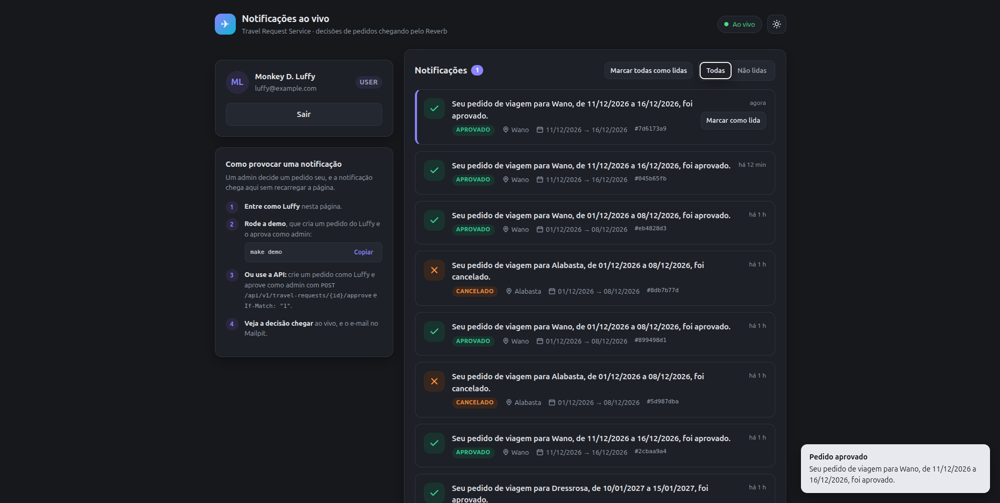
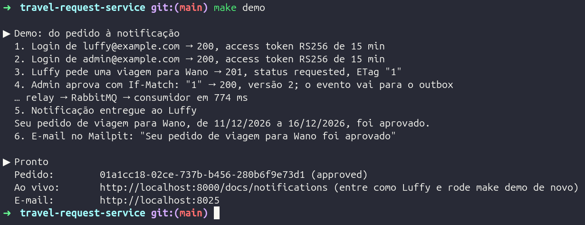
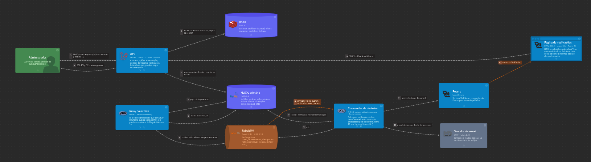
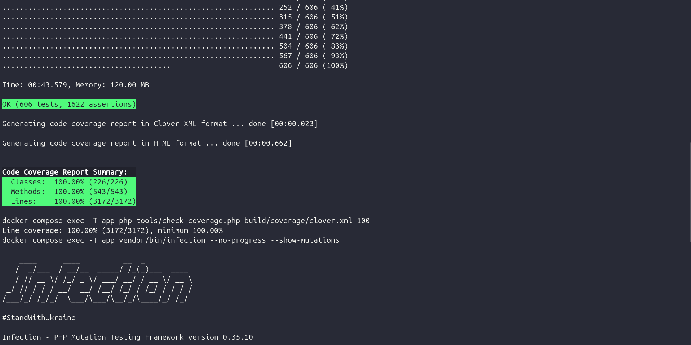

# Travel Request Service

Microsserviço para gestão de pedidos de viagem corporativa. Usuários autenticados por JWT criam e acompanham os próprios pedidos. Administradores aprovam ou cancelam, e a cada decisão o solicitante é notificado por e-mail, na API e em tempo real.

O serviço é feito em Laravel e dividido em três contextos: Identity, TravelRequest e Notification. Além da API, o projeto traz:
- observabilidade, com traces de ponta a ponta, métricas, logs e alertas;
- testes de carga com metas definidas e resultados medidos;
- diagramas de arquitetura navegáveis, com os fluxos reproduzidos passo a passo;
- uma página que mostra as notificações chegando ao vivo.



## Decisões

O teste foi tratado como um microsserviço de produção. Cada ponto foi decidido antes de ser implementado e registrado num ADR, e o trabalho foi dividido em fases, cada uma com plano, validação e pull request.

- **Arquitetura:** DDD com arquitetura hexagonal. As regras de negócio e os casos de uso não dependem do Laravel; o framework fica nas bordas (HTTP, banco e mensageria).
- **Mudança de status:** aprovar e cancelar são ações próprias (`/approve` e `/cancel`), restritas ao administrador, em vez de um campo editável.
- **Concorrência:** cada pedido tem uma versão, e toda escrita informa a versão em que se baseia (`If-Match`). Duas decisões simultâneas nunca valem as duas.
- **Notificação confiável:** a decisão e o evento que a anuncia são gravados na mesma transação. Um processo separado publica o evento no RabbitMQ, e o consumidor entrega por e-mail, na API e por WebSocket. Nada é entregue duas vezes, e uma falha volta a ser tentada até ir para uma fila de mensagens com erro.
- **Autenticação:** JWT assinado com chave assimétrica, access token de 15 minutos e refresh token rotativo, com revogação no logout.
- **Desempenho:** Octane com Swoole, cache no Redis e réplica de leitura do MySQL, com metas de latência medidas em testes de carga.
- **Qualidade:** 100% de cobertura e de mutation testing no domínio, análise estática no nível máximo e regras de arquitetura verificadas no CI.

Interpretações do enunciado:
- O administrador vê os pedidos de todos e pode aprovar o próprio pedido. O usuário comum vê, cria e edita só os seus.
- O nome do solicitante vem do usuário autenticado, não do corpo da requisição.
- Um pedido aprovado não pode ser cancelado: só pedidos ainda solicitados mudam de status.
- A API autenticada não tem limite de requisições, de propósito, para os testes de carga medirem o teto do serviço. O login tem limite.

O detalhe está em [docs/arquitetura.md](docs/arquitetura.md), e cada decisão em [docs/adr](docs/adr/README.md).

## Tecnologias

- **Runtime:** PHP 8.5, Laravel 13, Octane + Swoole 6.2
- **Banco de dados:** MySQL 8.4, primário e réplica de leitura
- **Cache:** Redis 8
- **Mensageria:** RabbitMQ 4.3
- **Notificações:** Laravel Reverb (WebSocket) e Mailpit (e-mail)
- **Autenticação:** JWT RS256 (lcobucci/jwt)
- **Observabilidade:** OpenTelemetry, Jaeger, Prometheus, Loki e Grafana
- **Documentação da API:** OpenAPI (Scramble)
- **Testes de carga:** k6
- **Infraestrutura:** Docker Compose e GitHub Actions

## Pré-requisitos

- Docker
- Docker Compose
- make

PHP, Composer e as demais dependências rodam dentro dos containers.

## Instalação

1. Clone o repositório:

   ```sh
   git clone https://github.com/pedrohlbarros/travel-request-service.git
   cd travel-request-service
   ```

2. Se alguma porta padrão já estiver em uso na sua máquina (por exemplo, um MySQL local na 3306), copie o `.env.example` para `.env` e troque a variável `FORWARD_*_PORT` correspondente. As variáveis estão comentadas no próprio arquivo.

3. Prepare o ambiente:

   ```sh
   make setup
   ```

   O comando cria o `.env`, builda a imagem e sobe os containers. Em seguida instala as dependências, cria o banco e a réplica, roda as migrations, gera as chaves do JWT e instala os git hooks.

4. Crie as contas de demonstração:

   ```sh
   make seed
   ```

   | Conta | Papel | Senha |
   |---|---|---|
   | `admin@example.com` | Administrador | `password123` |
   | `luffy@example.com` | Usuário | `password123` |
   | `zoro@example.com` | Usuário | `password123` |

5. A API responde em http://localhost:8000/api/v1. Para ver o fluxo completo, da criação do pedido à notificação, rode:

   ```sh
   make demo
   ```

   

Todos os comandos disponíveis estão em [docs/comandos.md](docs/comandos.md).

## Perfis do Docker Compose

| Perfil | Comando | Contém |
|---|---|---|
| Padrão | `make up` | API, publicador de eventos, consumidor de notificações, Reverb, MySQL primário e réplica, Redis, RabbitMQ e Mailpit |
| `obs` | `make obs` | OpenTelemetry Collector, Jaeger, Prometheus, Loki, Grafana e cAdvisor |
| `load` | `make load-*` | k6 |
| `docs` | `make docs` | Diagramas de arquitetura |

## Serviços

| Serviço | Descrição | URL | Sobe com |
|---|---|---|---|
| API | API REST | http://localhost:8000/api/v1 | `make up` |
| Documentação da API | OpenAPI | http://localhost:8000/docs/api | `make up` |
| Notificações | Página que mostra as notificações chegando ao vivo | http://localhost:8000/docs/notifications | `make up` |
| Mailpit | E-mails enviados | http://localhost:8025 | `make up` |
| RabbitMQ | Painel do broker (`travel_request` / `secret`) | http://localhost:15672 | `make up` |
| Grafana | Dashboards e alertas (`admin` / `admin`) | http://localhost:3000 | `make obs` |
| Jaeger | Traces | http://localhost:16686 | `make obs` |
| Prometheus | Métricas | http://localhost:9090 | `make obs` |
| Diagramas | Arquitetura em C4 (LikeC4), com os fluxos passo a passo | http://localhost:5173 | `make docs` |

Como os serviços conversam no fluxo de aprovação, da decisão do admin à notificação do solicitante:



## Testes e qualidade

```sh
make test   # todas as suítes
make qa     # tudo o que o CI roda
```

- **PHPUnit:** suítes unit, integration, feature e end-to-end, contra MySQL, Redis e RabbitMQ reais.
- **Infection:** mutation testing no domínio e nos casos de uso.
- **PHPStan + Larastan:** análise estática, com regras próprias do projeto.
- **Deptrac:** fronteiras entre camadas e entre contextos.
- **Pint:** estilo de código (PER).
- **CaptainHook:** Pint e PHPStan no pre-commit, Conventional Commits nas mensagens.
- **k6:** testes de carga.

A régua, que quebra o build no CI:
- 100% de cobertura de linhas;
- 100% de MSI e de Covered MSI;
- PHPStan no nível max, sem baseline;
- complexidade cognitiva até 9 por função;
- nenhuma violação de arquitetura.



Os detalhes estão no [guia de testes](docs/testes.md), e os cenários, as metas e os resultados de carga em [docs/testes-de-carga.md](docs/testes-de-carga.md).

## Documentação

- [Arquitetura](docs/arquitetura.md)
- [Comandos](docs/comandos.md)
- [Guia de testes](docs/testes.md)
- [Testes de carga](docs/testes-de-carga.md)
- [Decisões de arquitetura (ADRs)](docs/adr/README.md)
- [Catálogo de erros da API](docs/api/problems.md), [coleção de requests](docs/api/requests.http) e [OpenAPI](docs/api/openapi.json)

## Autor

Desenvolvido por [Pedro Barros](https://www.linkedin.com/in/pedrohlbarros).
